# GAMEZONE ARCADE
## Backend Development Fundamentals — Group Assignment

> **Cover page placeholder:** Insert the official Aurora university/department header or logo here.

| Report detail | Information |
|---|---|
| Project | GameZone Arcade |
| Course | Backend Development Fundamentals |
| Assignment total | 100 marks |
| Group ID | YG-CSEDS2B-G01 |
| Student preparing this copy | Nishant Kumar Thakur |
| Registration number | 252U1R3067 |
| Submission date | [Enter submission date] |

---

## 1. Project overview

GameZone Arcade is a backend API for a console gaming centre. It stores gamers, consoles, and bookings in an SQLite database and provides HTTP endpoints for managing them.

The project addresses the problem of console stations being occupied or left unused without a clear way to track reservations. The API lets the centre record gamers, maintain its console list, create bookings, find consoles by platform, and hide or restore consoles without permanently deleting their records.

### Main capabilities

- Register, view, update, and delete gamer records.
- Create, view, update, and soft-delete console records.
- Search active consoles by platform.
- Restore a soft-deleted console.
- Create and manage bookings.
- View booking details together with gamer and console names.
- Return HTTP status codes and JSON messages for successful and invalid requests.

### Technology used

- Node.js
- Express.js
- SQLite and the `sqlite3` package
- Postman
- Git and GitHub

---

## 2. Original assignment question

> **Screenshot placeholder:** Insert a readable screenshot of the original GameZone Arcade assignment question here. Include the requirements and special soft-delete/restore task.

---

## 3. How the system works

1. A client sends an HTTP request to the Express server.
2. Express middleware parses JSON request bodies.
3. A route matches the request method and URL.
4. The route validates the input and, when needed, sends a parameterized SQL query to SQLite.
5. Express returns a JSON response and an HTTP status code.

### Example booking flow

1. Add a gamer.
2. Add an active console.
3. Create a booking using the gamer and console IDs.
4. Request `GET /bookings/join` to see the booking with the gamer name and console name.

---

## 4. Database design

The database contains three related tables. A booking connects one gamer to one console using foreign keys.

| Table | Purpose | Important fields |
|---|---|---|
| `gamers` | Stores player details. | `id`, `name`, `email`, `phone`, `created_at` |
| `consoles` | Stores console details and visibility. | `id`, `name`, `platform`, `status`, `price_per_hour`, `is_deleted`, timestamps |
| `bookings` | Stores a gamer’s console reservation. | `id`, `gamer_id`, `console_id`, `booking_date`, `hours`, `total_amount`, `status`, `created_at` |

### Relationships and rules

- `gamers.id` and `consoles.id` are primary keys.
- `bookings.gamer_id` references `gamers.id`.
- `bookings.console_id` references `consoles.id`.
- Gamer email addresses are unique.
- Booking hours must be greater than zero.
- Console prices and booking totals cannot be negative.
- SQLite foreign-key enforcement is enabled during database initialization.
- `consoles.is_deleted` is `0` for an active console and `1` for a soft-deleted console.

> **Database screenshot included below:** The image shows the three table structures.

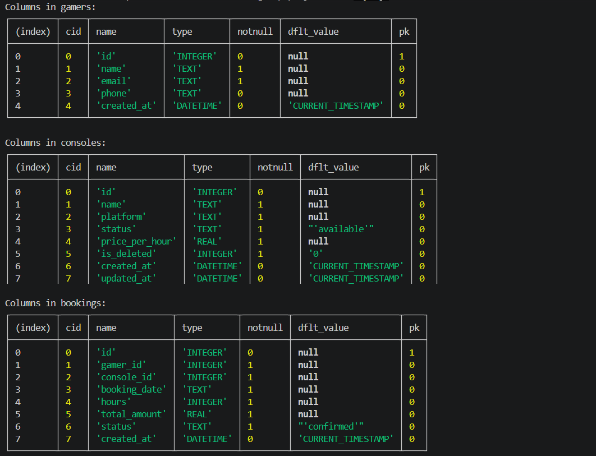

---

## 5. API routes

All examples use `http://localhost:3000` as the base URL.

### Server

| Method | Route | Purpose |
|---|---|---|
| `GET` | `/` | Shows API status and the main routes. |
| `GET` | `/health` | Confirms that the API is running. |

### Gamers

| Method | Route | Purpose |
|---|---|---|
| `GET` | `/gamers` | Lists gamers. |
| `GET` | `/gamers/:id` | Gets one gamer. |
| `POST` | `/gamers` | Creates a gamer. |
| `PUT` | `/gamers/:id` | Updates a gamer. |
| `DELETE` | `/gamers/:id` | Deletes a gamer. |

### Consoles

| Method | Route | Purpose |
|---|---|---|
| `GET` | `/consoles` | Lists active consoles. |
| `GET` | `/consoles?platform=PlayStation` | Filters active consoles by platform. |
| `GET` | `/consoles/:id` | Gets one active console. |
| `POST` | `/consoles` | Creates a console. |
| `PUT` | `/consoles/:id` | Updates an active console. |
| `DELETE` | `/consoles/:id` | Soft-deletes a console. |
| `POST` | `/consoles/:id/restore` | Restores a soft-deleted console. |

### Bookings

| Method | Route | Purpose |
|---|---|---|
| `GET` | `/bookings` | Lists bookings. |
| `GET` | `/bookings/:id` | Gets one booking. |
| `POST` | `/bookings` | Creates a booking. |
| `PUT` | `/bookings/:id` | Updates a booking. |
| `DELETE` | `/bookings/:id` | Deletes a booking. |
| `GET` | `/bookings/join` | Lists booking details with gamer and console names. |
| `GET` | `/bookings/details` | Alternative route returning joined booking details. |

### Common response codes

| Status | Meaning in this API |
|---|---|
| `200 OK` | A request succeeded, such as a read, update, delete, or restore. |
| `201 Created` | A gamer, console, or booking was created. |
| `400 Bad Request` | The request body or a field is invalid or missing. |
| `404 Not Found` | The requested record or route was not found or is hidden. |
| `409 Conflict` | A gamer email is already in use. |
| `500 Internal Server Error` | A database or unexpected server error occurred. |

---

## 6. Contributions by person

> **Screenshot guidance:** Replace each code placeholder with a readable VS Code screenshot of the listed section. The Postman and database output screenshots are included in Section 7; their filenames are given below so they can be moved next to the relevant contribution if preferred.

### Person 1 — Nishant Kumar Thakur
**Registration number:** 252U1R3067  
**Responsibility:** Server and routes

- Set up the Express application and port configuration.
- Added JSON request middleware, the home route, and the health-check route.
- Added the not-found route and server startup after database initialization.
- Used HTTP methods and status codes to form the API’s request/response behavior.

**Code screenshot placeholder:** Insert the Express setup, middleware, health route, 404 handler, and startup code.

**Output evidence:** [Server startup](./screenshots/postman/02-server-startup.png) · [Health check](./screenshots/postman/01-health-check.png) · [Unknown route](./screenshots/postman/11-invalid-route.png)

### Person 2 — Sree Charani
**Registration number:** 252U1R3059  
**Responsibility:** SQL database

- Connected the application to SQLite.
- Initialized the `gamers`, `consoles`, and `bookings` tables.
- Set up primary-key, foreign-key, uniqueness, default, and value constraints.
- Added query helpers used by routes to run SQL and retrieve rows.

**Code screenshot placeholder:** Insert the SQLite connection, query helper functions, and table initialization/schema code.

**Output evidence:** [Database structure](./screenshots/postman/03-database-structure.png)

### Person 3 — Aditya Prasoon
**Registration number:** 252U1R3095  
**Responsibility:** REST endpoints and booking JOIN

- Implemented the gamer, console, and booking CRUD route operations.
- Added the booking JOIN that returns gamer and console names with booking details.
- Used parameterized SQL values when processing request data.

**Code screenshot placeholder:** Insert the console CRUD routes, booking routes, and `GET /bookings/join` SQL query.

**Output evidence:** [Console CRUD](./screenshots/postman/04-console-crud.png) · [Create gamer](./screenshots/postman/07-create-gamer.png) · [Booking operations](./screenshots/postman/08-booking-operations.png) · [Booking JOIN](./screenshots/postman/09-booking-join.png)

### Person 4 — Manoj Kumar Reddy
**Registration number:** 252U1R3076  
**Responsibility:** Validation and PUT request checks

- Added checks for required fields and acceptable input values.
- Added validation for booking IDs, hours, and monetary values.
- Added clear JSON error responses for invalid requests.
- Checked update requests so invalid or empty values are rejected.

**Code screenshot placeholder:** Insert the validation helpers and representative POST/PUT validation code.

**Output evidence:** [Validation errors](./screenshots/postman/10-validation-errors.png) · [Duplicate email](./screenshots/postman/12-duplicate-email-error.png)

### Person 5 — Niharika
**Registration number:** 252U1R3070  
**Responsibility:** Soft delete and restore

- Added the console `is_deleted` flag.
- Hid deleted consoles from normal console list and get-by-ID requests.
- Changed console deletion to update the flag instead of removing the row.
- Added the restore route and prevented new or updated bookings from using deleted consoles.

**Code screenshot placeholder:** Insert the console soft-delete route, restore route, and active-console filters.

**Output evidence:** [Soft delete and restore](./screenshots/postman/05-soft-delete-restore.png)

> **Additional screenshot placeholder:** Add one clear Postman capture or sequence showing all three required steps: `DELETE /consoles/:id` returns `200`, `GET /consoles/:id` returns `404`, and `POST /consoles/:id/restore` returns `200`. The current screenshot shows the restore response; make sure the delete and hidden-fetch responses are also visible in the final submission evidence.

### Person 6 — Tilak
**Registration number:** 252U1R3096  
**Responsibility:** Documentation, Postman testing, and screenshots

- Prepared the Postman collection and documented project setup and API usage.
- Organized the request and response screenshots used as project evidence.
- Captured examples for successful requests, validation errors, and database structure.

**Code/documentation screenshot placeholder:** Insert a screenshot of the README and the Postman collection organization.

**Output evidence:** Postman screenshots are included in Section 7. The collection is available at [GameZone Arcade Postman collection](./.postman/GameZone-Arcade.postman_collection.json).

---

## 7. Postman and execution evidence

The project includes a Postman collection and screenshots of the server, database, API responses, search, validation, and error handling.

The repository does not define an automated `npm test` script. The evidence below is from the provided Postman screenshots and collection; use the collection for a final manual run before submission.

### Server and database

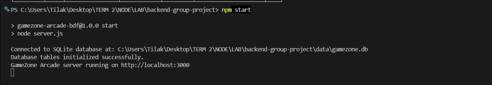


### Health check and console APIs

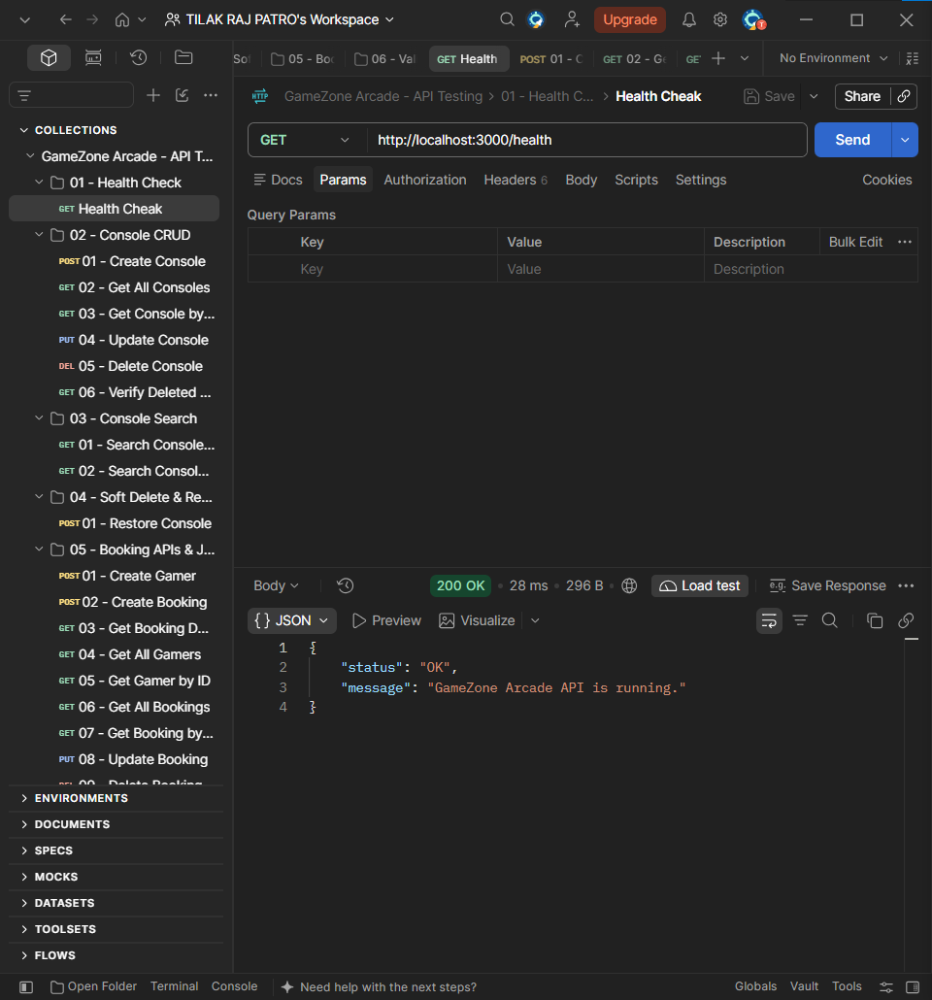

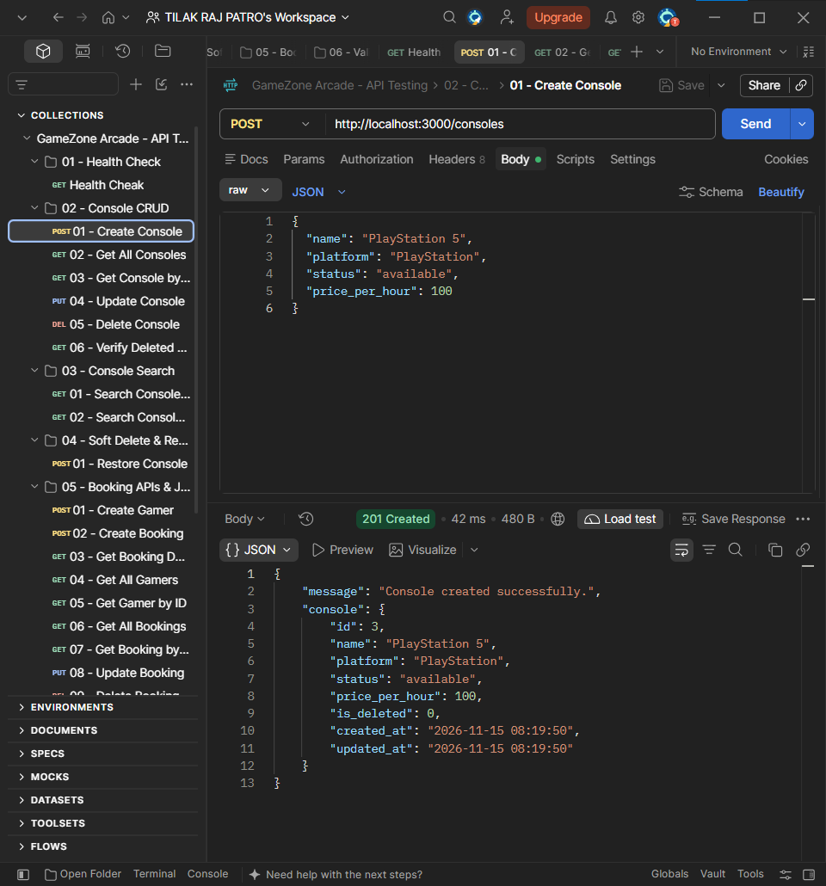

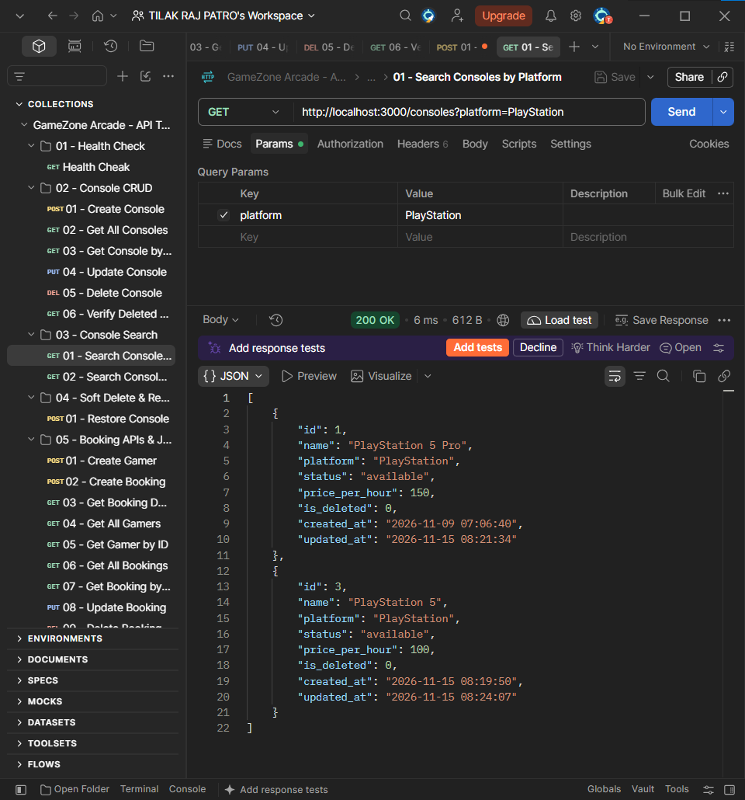

### Soft delete and restore

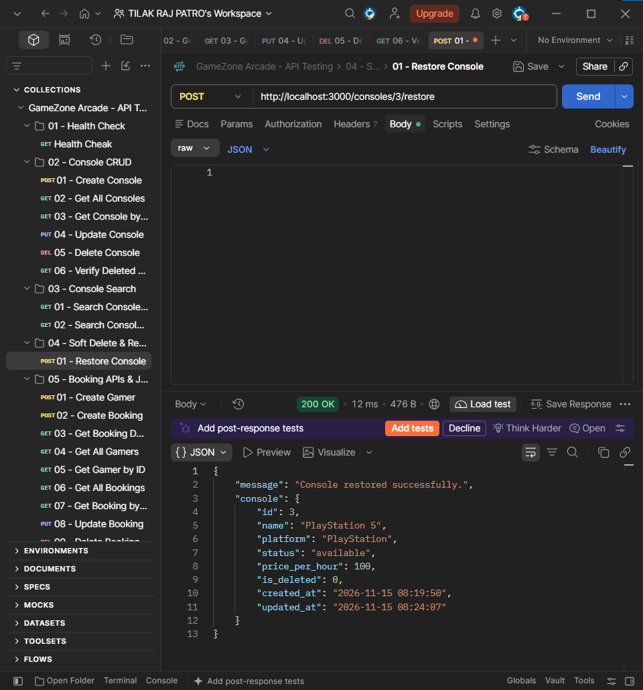

### Gamers, bookings, and JOIN

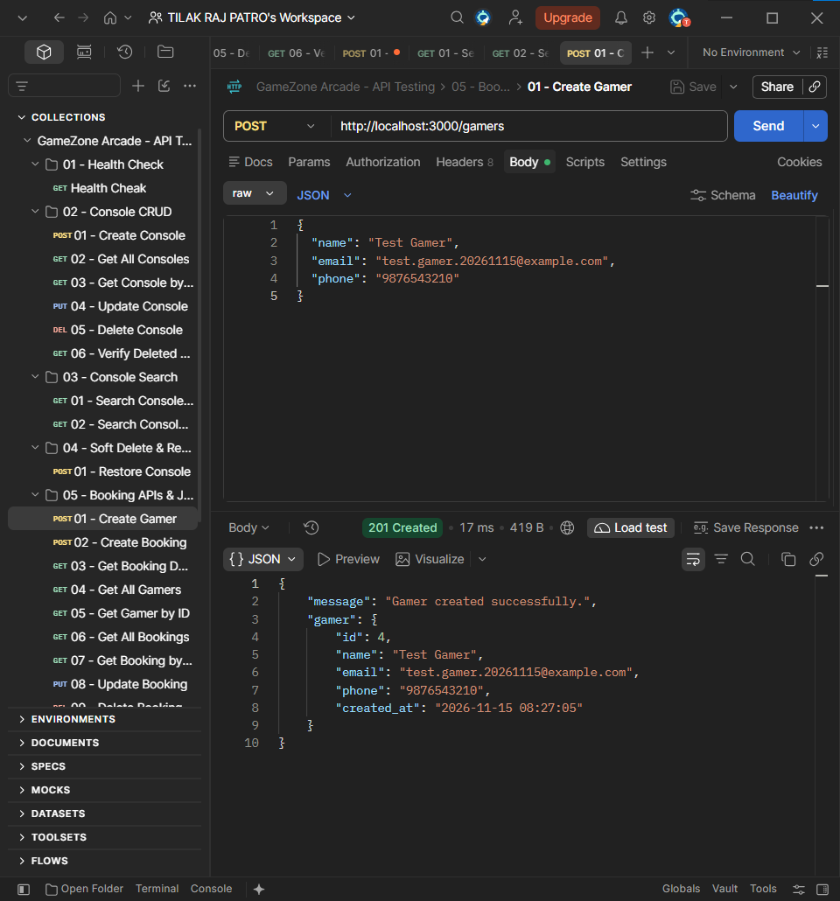

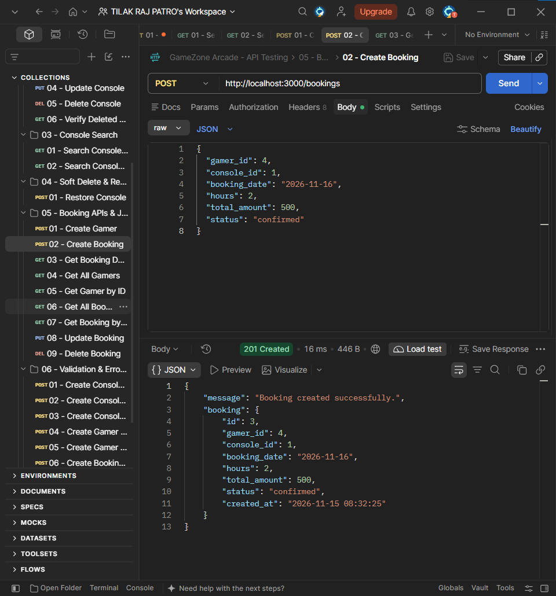

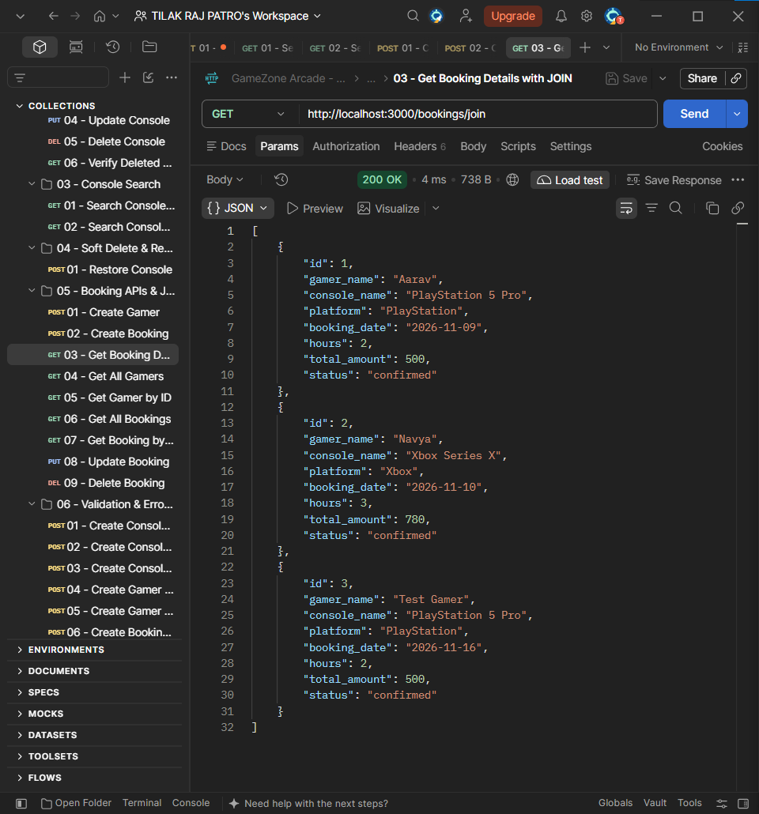

### Validation and error cases

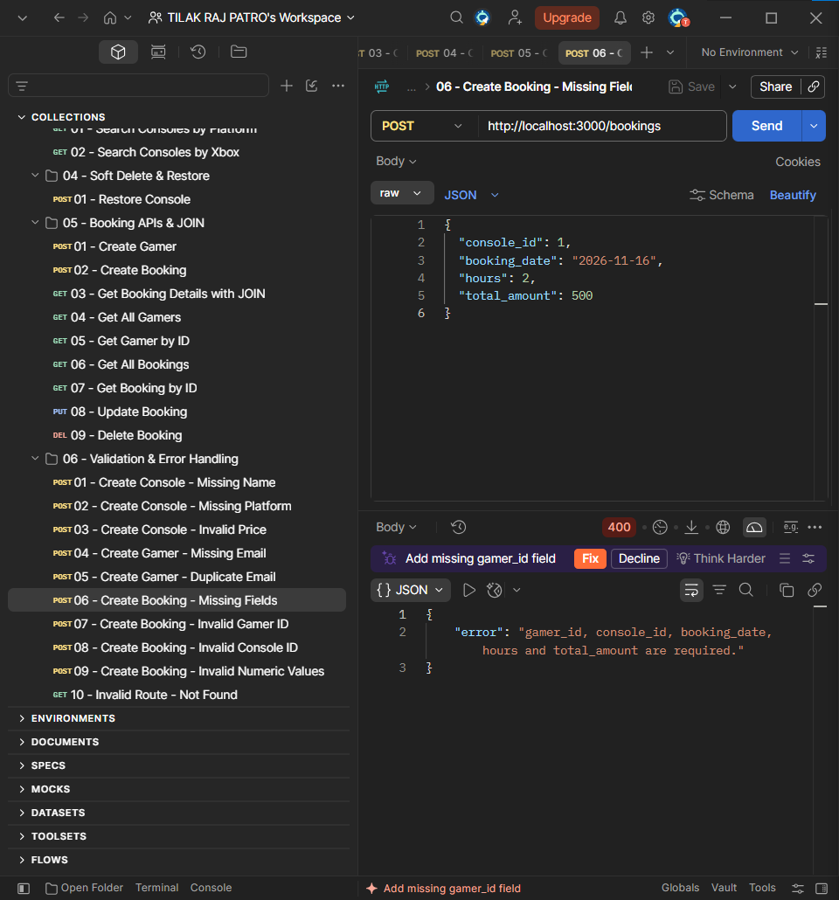

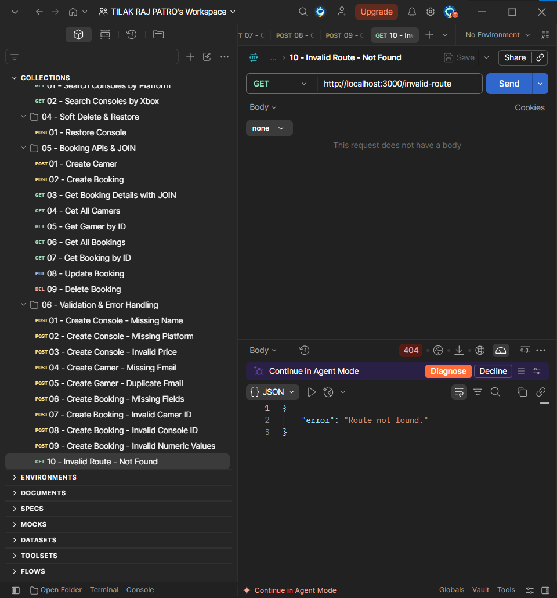

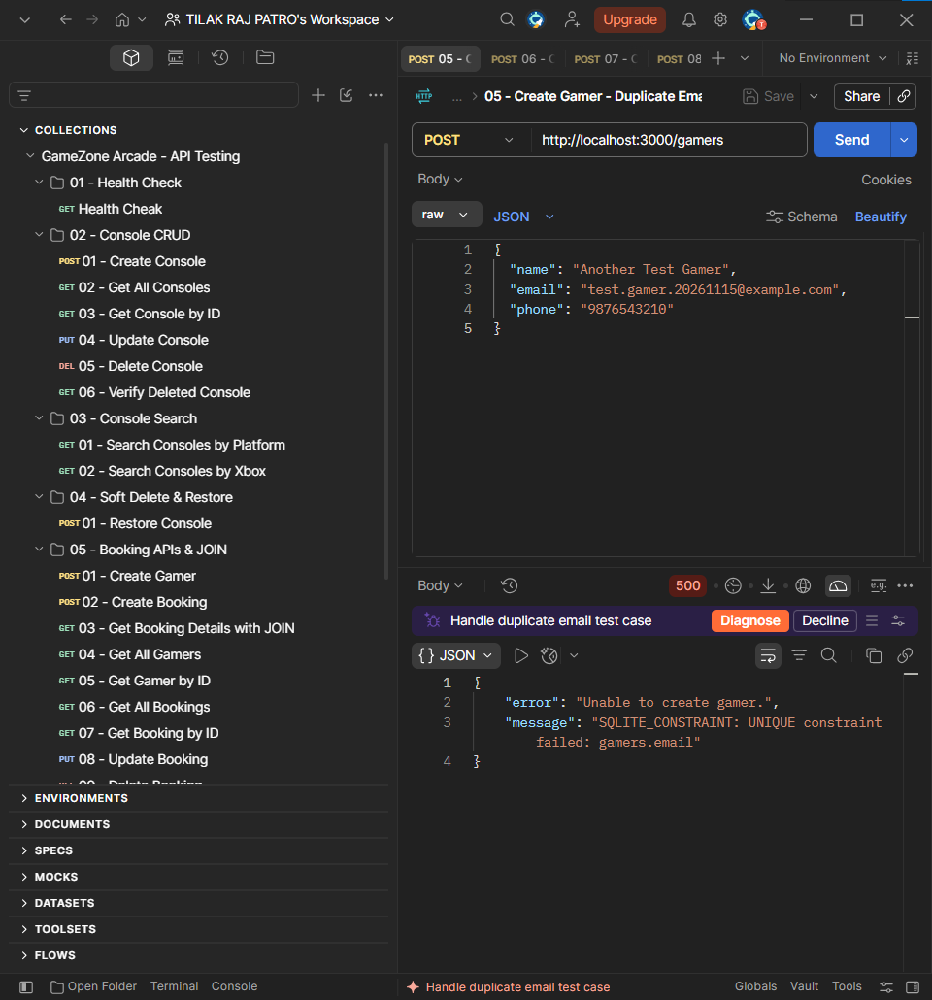

---

## 8. Assignment completion checklist

### Group project requirements

- [x] Express server with routes.
- [x] SQLite database with `gamers`, `consoles`, and `bookings` tables.
- [x] Relationships between bookings, gamers, and consoles.
- [x] CRUD endpoints for gamers, consoles, and bookings.
- [x] Booking JOIN endpoint includes gamer and console names.
- [x] Input checks and clear JSON errors.
- [x] Console search by platform query parameter.
- [x] Console soft deletion and restoration.
- [x] Postman collection and API evidence screenshots included in the repository.
- [x] README contains setup instructions and endpoint examples.

### Individual report items to confirm before export

- [ ] Insert the official Aurora university/department header on the cover.
- [ ] Insert the original assignment-question screenshot in Section 2.
- [ ] Insert the code screenshots at each person’s placeholder in Section 6.
- [ ] Include a screenshot or sequence proving console delete (`200`), hidden fetch (`404`), and restore (`200`).
- [ ] Confirm the full official names and registration numbers with all group members.
- [ ] Confirm the required peer-rating, commit, or individual-demo evidence is attached separately if the instructor requests it.

---

## 9. Running the project

From the project directory:

```bash
npm install
npm start
```

The server runs at `http://localhost:3000`. To verify it is responding, request:

```http
GET http://localhost:3000/health
```

The expected response has status `200 OK` and JSON indicating that the API is running.

---

## 10. Conclusion

GameZone Arcade demonstrates a small backend system using Express and SQLite. It connects gamers, consoles, and bookings; exposes CRUD and JOIN endpoints; validates requests; supports console search; and demonstrates soft deletion and restoration. The Postman collection and screenshots provide practical evidence of the project’s behavior.

> **Final submission reminder:** Add the requested cover header, assignment screenshot, and code screenshots before converting this Markdown report to Word.
